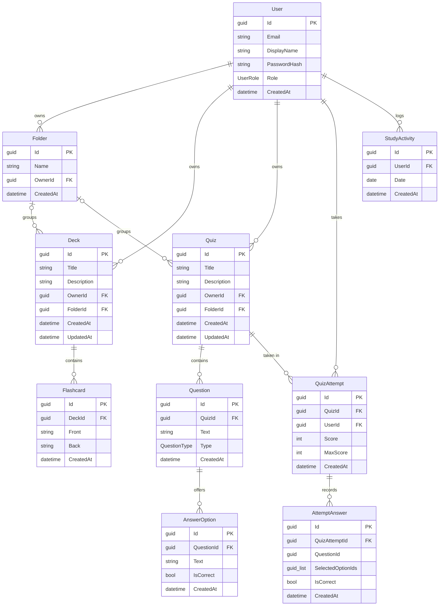

# Data model (ERD)

The application stores its data in PostgreSQL. Every table has a GUID primary key
(`Id`) and a `CreatedAt` timestamp inherited from a shared base entity. The diagram
below shows the entities and their relationships.

## Notes

- `Deck.FolderId` and `Quiz.FolderId` are optional: a deck or quiz may sit directly under
  its owner without belonging to a folder.
- `AttemptAnswer.QuestionId` and `AttemptAnswer.SelectedOptionIds` are stored as plain
  values rather than enforced foreign keys. An attempt is an immutable record of what the
  user answered, so it stays intact even if the quiz is edited or a question is removed
  afterwards.
- `StudyActivity` has a unique index on `(UserId, Date)` so a user has at most one activity
  record per calendar day, which is what the streak calculation counts.
